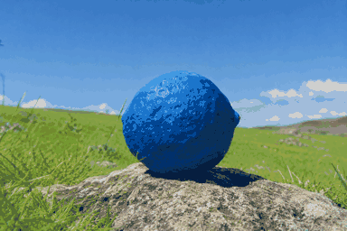

# Tiny CPU AI Models

**Making local AI accessible on everyday CPUs — one simple command, no cloud required.**

Most AI projects focus on larger models and cloud infrastructure. This project explores the opposite: **small, lightweight, open-source language and vision models** that can run **offline on low-resource devices using only a CPU**.

The goal is twofold: **make AI easier for everyone to use**, with minimal setup and no technical AI stack to install; and build a **reproducible collection of compact models for experimentation, benchmarking, and task-specific fine-tuning**. Smaller models can be especially attractive for efficient adaptation to specialized tasks, although fine-tuning effectiveness still depends on the model, data, and task.

```bash
python run.py MODEL_ID "Your prompt"
```

**Requirements:** Python 3.9+; internet access only for the first download. No Ollama, Docker, PyTorch, Transformers, Hugging Face Python packages, accounts, or API keys. Models run locally on CPU and can be reused offline.

## Quick start

```bash
git clone https://github.com/edujbarrios/tiny-cpu-ai-models.git
cd tiny-cpu-ai-models
python run.py granite-350m "Tell me something interesting."
```

That's it. On first use, the script automatically downloads the model and CPU runtime. No `pip install`, Ollama, or Hugging Face installation required.

**Python command:** If `python` is not available, use `python3` (common on Linux/macOS) or `py -3` (Windows).


## Command-line interface

```text
python run.py MODEL_ID "Your prompt" [OPTIONS]
```

```bash
python run.py --models
python run.py granite-350m "Explain how neural networks work."
python run.py granite-350m
python run.py granite-350m "Hello" --max-tokens 128
python run.py granite-350m "Hello" --threads 4
python run.py granite-350m "Hello" --ctx-size 2048
python run.py granite-350m "Hello" --offline
python run.py --help
```

Omit the prompt for interactive chat. `--offline` disables downloads after the model and runtime have been cached.

**One consistent interface for every registered model.** Use `python run.py --models` to list models and see a ready-to-copy test command for each one (`--list` is also supported). The launcher does not hard-code a particular model.

## Available models

```bash
python run.py --models
```

The catalog separates **text** and **vision** models and prints a ready-to-copy command for each one.

### Text models

| Model ID | Model | Parameters | Quantization | Download size | License |
| --- | --- | ---: | --- | ---: | --- |
| `granite-350m` | [IBM Granite 4.0 350M](https://huggingface.co/ibm-granite/granite-4.0-350m) | 350M | Q4_K_M | 237 MB | Apache-2.0 |
| `smollm2-135m` | [SmolLM2 135M Instruct](https://huggingface.co/HuggingFaceTB/SmolLM2-135M-Instruct) | 135M | Q4_K_M | 105 MB | Apache-2.0 |
| `smollm2-360m` | [SmolLM2 360M Instruct](https://huggingface.co/HuggingFaceTB/SmolLM2-360M-Instruct) | 360M | Q4_K_M | 271 MB | Apache-2.0 |
| `qwen2.5-0.5b` | [Qwen2.5 0.5B Instruct](https://huggingface.co/Qwen/Qwen2.5-0.5B-Instruct) | 500M | Q4_K_M | 491 MB | Apache-2.0 |

#### Tested CPU performance — text

| Model | CPU | Quantization | Prompt processing | Generation speed | Response time |
| --- | --- | --- | ---: | ---: | ---: |
| `granite-350m` | Intel Core i7-1165G7 (Tiger Lake, 4 cores / 8 threads, up to 4.7 GHz) | Q4_K_M | 281.1 tok/s | 42.4 tok/s | 3.58 s |
| `smollm2-135m` | Intel Core i7-1165G7 (Tiger Lake, 4 cores / 8 threads, up to 4.7 GHz) | Q4_K_M | 528.9 tok/s | 111.6 tok/s | 2.43 s |
| `smollm2-360m` | Intel Core i7-1165G7 (Tiger Lake, 4 cores / 8 threads, up to 4.7 GHz) | Q4_K_M | 232.8 tok/s | 38.4 tok/s | 1.50 s |
| `qwen2.5-0.5b` | Intel Core i7-1165G7 (Tiger Lake, 4 cores / 8 threads, up to 4.7 GHz) | Q4_K_M | 180.4 tok/s | 30.9 tok/s | 3.62 s |


#### Run a text model

```bash
python run.py granite-350m "Tell me something interesting."
python run.py smollm2-135m "Tell me something interesting."
python run.py smollm2-360m "Tell me something interesting."
python run.py qwen2.5-0.5b "Tell me something interesting."
```

### Vision models

| Model ID | Model | Parameters | Quantization | Download size | License |
| --- | --- | ---: | --- | --- | --- |
| `smolvlm2-256m` | [SmolVLM2 256M Video Instruct](https://huggingface.co/HuggingFaceTB/SmolVLM2-256M-Video-Instruct) | 256M | Q4_K_M | 131 MB model + 104 MB projector | Apache-2.0 |
| `moondream-2b` | [Moondream2 (2025-04-14)](https://huggingface.co/ggml-org/moondream2-20250414-GGUF) | ~2B | F16 | 2.84 GB model + 910 MB projector | Apache-2.0 |


Moondream2 uses the GGUF's embedded Vicuna template with `--no-jinja` for correct CPU image inference. This setting is applied automatically by the runner. It requires considerably more RAM and storage than SmolVLM2.

#### Visual recognition benchmark



**Reference description (ground truth supplied by the image creator):** A bright blue lemon, deliberately textured to resemble a golf ball, resting on a rock in a sunny green meadow. The unusual color and hybrid appearance are intended to challenge visual object recognition. **The correct identification is a blue lemon, not a golf ball.**

**Benchmark prompt (English):** `Describe the main object, its color, shape, and setting.`

```bash
python run.py smolvlm2-256m "Describe the main object, its color, shape, and setting." --image benchmark_image/example.png
python run.py moondream-2b "Describe the main object, its color, shape, and setting." --image benchmark_image/example.png
```

Both vision models download their weights and visual projectors automatically. For a fair comparison, use the same benchmark image and exact prompt. Both models have been benchmarked on the Intel Core i7-1165G7 using this image.

#### Tested CPU performance — vision

The same blue-lemon benchmark is recorded as parameterized YAML, with one entry per model. `correct_identification` is a boolean: `true` ✅ for recognizing the blue lemon, `false` ❌ otherwise. Timings include model loading, prompt processing, and generation.

[View or reuse results.yaml](benchmark_image/results.yaml).

```yaml
benchmark:
  image: benchmark_image/example.png
  cpu: "Intel Core i7-1165G7 (Tiger Lake, 4 cores / 8 threads)"
  ground_truth: "Blue lemon with golf-ball-like texture on a rock in a grassy meadow"
  prompt: "Describe the main object, its color, shape, and setting."
  correct_if: "Correct if the main object is identified as a blue lemon"
  models:
    smolvlm2-256m:
      model_name: "SmolVLM2 256M Video Instruct"
      quantization: Q4_K_M
      correct_identification: false  # ❌
      response: >-
        The object is a blue-colored ball with a smooth texture, likely made from a
        natural material like concrete or plastic. It's placed on a rock, possibly in a
        grassy field or a rocky slope, with the sky visible in the background. The
        colors are vibrant and have a serene, natural aesthetic.
      performance:
        prompt_tps: 48.6
        generation_tps: 65.4
        response_time_s: 20.15
    moondream-2b:
      model_name: "Moondream2 ~2B (2025-04-14)"
      quantization: F16
      correct_identification: true  # ✅
      response: >-
        The main object is a blue lemon sitting on a rock in a grassy field. The lemon
        is round in shape and has a vibrant blue color, making it a visually striking
        and unique scene in the image. The setting appears to be a grassy field or
        pasture, providing a natural backdrop that complements the bright blue hue of
        the lemon.
      performance:
        prompt_tps: 40.6
        generation_tps: 7.4
        response_time_s: 34.41
```

**Download provenance:** Granite and Qwen use publisher-hosted GGUF repositories. SmolLM2 variants use quantizations published by QuantFactory and LM Studio Community; SmolVLM2 GGUF and projector come from ggml-org, while the Moondream2 2025 F16 GGUF and matching projector come from ggml-org. All downloads use HTTPS with SHA-256 verification, and no Hugging Face software installation is required. The `granite` alias still resolves to `granite-350m`.

## Adding another model

**No changes to `run.py` are required for new llama.cpp-compatible GGUF models.** Add a record to [`models.json`](models.json), using a unique model ID, a direct HTTPS download URL, and its verified SHA-256 checksum. Then use:

```bash
python run.py my-model "Tell me something."
```

For example, this is a *template*, not an installed model:

```json
{
  "my-model": {
    "name": "Example open model",
    "type": "text",
    "runtime": "llama.cpp",
    "parameters": "250M",
    "license": "Apache-2.0",
    "source": "Original publisher",
    "filename": "example-Q4_K_M.gguf",
    "url": "https://example.org/example-Q4_K_M.gguf",
    "sha256": "REPLACE_WITH_A_VERIFIED_64_CHARACTER_SHA256_HASH",
    "context_size": 2048
  }
}
```

Insert this as another entry alongside `granite-350m`, not as a replacement for the complete catalog. The launcher will fetch and verify the weights on first use.

### Vision models (VLMs)

The launcher supports **vision models compatible with llama.cpp**, including a separate visual projector. SmolVLM2 is the first registered VLM. Register `"type": "vision"` and an `"mmproj"` object containing its own `filename`, `url` and `sha256`:

```json
{
  "example-vlm": {
    "name": "Example vision model",
    "type": "vision",
    "runtime": "llama.cpp",
    "parameters": "256M",
    "license": "Apache-2.0",
    "filename": "example-vlm.gguf",
    "url": "https://example.org/example-vlm.gguf",
    "sha256": "REPLACE_WITH_A_VERIFIED_64_CHARACTER_SHA256_HASH",
    "mmproj": {
      "filename": "example-mmproj.gguf",
      "url": "https://example.org/example-mmproj.gguf",
      "sha256": "REPLACE_WITH_A_VERIFIED_64_CHARACTER_SHA256_HASH"
    }
  }
}
```

Once **actual compatible files and checksums** are provided, a registered VLM can use:

```bash
python run.py example-vlm "Describe this picture." --image photo.jpg
```

Vision support is an integration point; performance and compatibility should be validated per model and CPU platform. Some models require different runtimes or additional preprocessing, which will need separate adapters. The current version targets llama.cpp-compatible GGUF language models and supported VLM architectures; it is **not** a universal runtime for arbitrary model formats.

More details and contribution guidelines: [CONTRIBUTING.md](CONTRIBUTING.md).

## Direct downloads, without Hugging Face or Ollama installation

- **CPU runtime:** downloads a pinned official [llama.cpp](https://github.com/ggml-org/llama.cpp) CPU build from [GitHub Releases](https://github.com/ggml-org/llama.cpp/releases), verified with SHA-256. Version, per-platform URLs and checksums live in [`runtimes.json`](runtimes.json); the launcher does not call the GitHub API.
- **Granite weights:** downloads the official [IBM Granite GGUF](https://huggingface.co/ibm-granite/granite-4.0-350m-GGUF) directly over HTTPS and verifies SHA-256.
- **No Hugging Face installation:** while the official IBM model files are hosted on Hugging Face, there is **no Hugging Face CLI, Python package, or account requirement**.
- **Local cache:** downloaded files live in `.cache/`; inference runs locally and can be repeated offline with `--offline`.

The code uses only Python's standard library; no `pip install`, no Ollama, and no Docker. Pinning the runtime version and verifying checksums improves reproducibility.

## System requirements

- Python **3.9+**.
- Windows x64/ARM64, macOS x64/ARM64, or Linux x64/ARM64 **where matching CPU binaries are available**.
- No GPU required (`--gpu-layers 0` and no visual projector GPU offload).
- Allow at least 500 MB of storage for Granite and the runtime, plus temporary extraction space.
- RAM use depends on model size, context window, and system; it exceeds the size of the GGUF file.

Linux binaries provided upstream may require compatible system libraries. CPU inference speeds vary; benchmarks should state CPU, model, quantization, and measured tokens per second.

## Testing

```bash
python -m unittest discover -s tests -v
python run.py --models
python run.py granite-350m "Hello" --max-tokens 24
python run.py granite-350m "Hello again" --offline --max-tokens 24
```

GitHub Actions checks Python unit tests on Windows, macOS and Linux, and performs an end-to-end Granite CPU smoke test on Linux.

## Licenses

Original code in this repository is licensed under [MIT](LICENSE). IBM Granite weights are licensed under **Apache-2.0**; llama.cpp is licensed under **MIT**. We download the respective artifacts from their upstream publishers and do not bundle them in this repository.

---

**Mission:** `clone → choose a model → run`. Open, small, local AI should not require an entire AI software stack.
