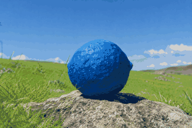

# VLM CPU benchmarks

[← Back to the main README](../README.md)

## Test environment

- CPU recorded for the benchmark collection: Intel Core i7-1165G7 (Tiger Lake, 4 cores / 8 threads).
- CPU-only inference. The Qwen3.5 and LFM2-VL logs report llama.cpp build `b12651-f5e6915c2`; they do not independently identify the CPU.
- Timings include loading, prompt processing and generation, excluding initial downloads.

## Visual recognition benchmark



**Reference description (ground truth supplied by the image creator):** A bright blue lemon, deliberately textured to resemble a golf ball, resting on a rock in a sunny green meadow. The unusual color and hybrid appearance are intended to challenge visual object recognition. **The correct identification is a blue lemon, not a golf ball.**

**Benchmark prompt (English):** `Describe the main object, its color, shape, and setting.`

```bash
python run.py smolvlm2-256m "Describe the main object, its color, shape, and setting." --image benchmark_image/example.png
python run.py moondream-2b "Describe the main object, its color, shape, and setting." --image benchmark_image/example.png
python run.py lfm2-vl-450m "Describe the main object, its color, shape, and setting." --image benchmark_image/example.png
python run.py qwen3.5-0.8b "Describe the main object, its color, shape, and setting." --image benchmark_image/example.png
```

All vision models download their weights and visual projectors automatically. Use the same image and exact prompt for comparison.

## Performance and qualitative analysis

| Model | Quantization | Correct identification | Qualitative visual reasoning / description | Prompt processing | Generation speed | Response time |
| --- | --- | --- | --- | ---: | ---: | ---: |
| `smolvlm2-256m` | Q4_K_M | ❌ | Basic; mistakes lemon for a ball | 48.6 tok/s | 65.4 tok/s | 20.15 s |
| `moondream-2b` | F16 | ✅ | Accurate, concise identification | 40.6 tok/s | 7.4 tok/s | 34.41 s |
| `lfm2-vl-450m` | Q4_0 | ❌ | **Standout descriptive detail**; recognizes fruit-like shape but invents a pair and plastic material | 157.9 tok/s | 51.4 tok/s | 13.80 s |
| `qwen3.5-0.8b` | Q4_K_M | ✅ (thinking only) | **Standout explicit reasoning**; recognizes lemon, color and texture; final answer incomplete | 63.5 tok/s | 21.6 tok/s | 36.26 s |

**Qualitative observation:** Qwen3.5 and LFM2-VL stand out for the detail and organization of their visual analysis in these samples. Qwen3.5 explicitly reasons about the object, texture, color and scene; LFM2-VL produces a fluent and detailed scene description quickly. This is not a validated reasoning ranking: LFM2-VL misidentifies the number and nature of the object, while Qwen3.5 never finishes its final answer. Moondream2 gives the most reliable completed identification in this test.

LFM2-VL has the fastest recorded prompt processing and shortest end-to-end response time. SmolVLM2 has the highest generation throughput. Qwen3.5's generation rate includes thinking tokens, and its timing represents an incomplete run. One image and one run per model do not establish general visual reasoning ability.

## Individual model outputs

### SmolVLM2 256M Instruct — Q4_K_M

The object is a blue-colored ball with a smooth texture, likely made from a natural material like concrete or plastic. It's placed on a rock, possibly in a grassy field or a rocky slope, with the sky visible in the background. The colors are vibrant and have a serene, natural aesthetic.

- Identification: incorrect.
- Prompt: 48.6 tok/s; generation: 65.4 tok/s; response time: 20.15 s.

### Moondream2 ~2B (2025-04-14) — F16

The main object is a blue lemon sitting on a rock in a grassy field. The lemon is round in shape and has a vibrant blue color, making it a visually striking and unique scene in the image. The setting appears to be a grassy field or pasture, providing a natural backdrop that complements the bright blue hue of the lemon.

- Identification: correct in the completed response.
- Prompt: 40.6 tok/s; generation: 7.4 tok/s; response time: 34.41 s.

### LFM2-VL 450M — Q4_0

The main object is a pair of blue, plastic fruit spheres. They are round and vibrant blue, standing out against the natural setting. The spheres are positioned on a large gray rock in a field of green grass. The background features a clear blue sky with some clouds and distant mountains. The image has a realistic feel, capturing the blue color of the spheres and the surrounding environment in great detail.

- Identification: incorrect (describes two plastic fruit spheres rather than one blue lemon).
- Detailed, coherent description of color and setting; some object details are wrong.
- Prompt: 157.9 tok/s; generation: 51.4 tok/s; response time: 13.80 s.

### Qwen3.5 0.8B — Q4_K_M

[Start thinking]

The user wants a description of the main object in the image.

1.  **Identify the object:** It's a sphere. It looks like a lemon. The texture is bumpy and textured, not smooth like a plastic ball.
2.  **Identify the color:** It's a very vibrant, deep blue. It looks almost plasticized or coated. It contrasts sharply with the earthy tones of the rock and grass.
3.  **Identify the shape:** It is perfectly spherical.
4.  **Identify the setting:**
    *   It's sitting on a large, grey rock.
    *   The rock is on a grassy hill.
    *   There is a bright, sunny day with a clear blue sky.
    *   The background is a lush green landscape, slightly out of focus (bokeh), suggesting a landscape park or nature trail.

\*\*Drafting the

- Identification: correct in thinking only; response incomplete.
- Prompt: 63.5 tok/s; generation: 21.6 tok/s; response time: 36.26 s.

## Recording new runs

Record the exact prompt, model output (including whether it is complete), model quantization, hardware, runtime version, token limit, prompt and generation rates, and elapsed time. Evaluate object identification separately from descriptive detail. Keep prior observations unless they are explicitly superseded by a new run.
